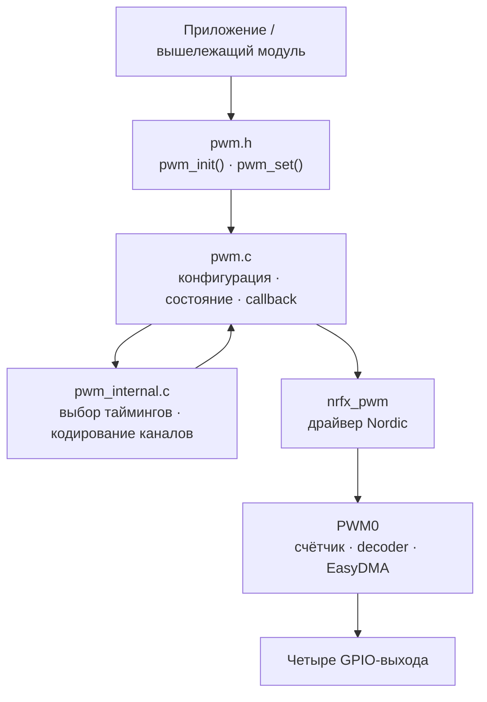
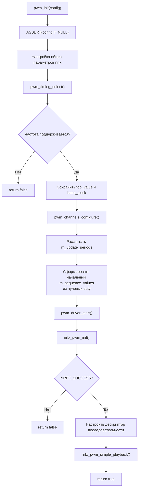
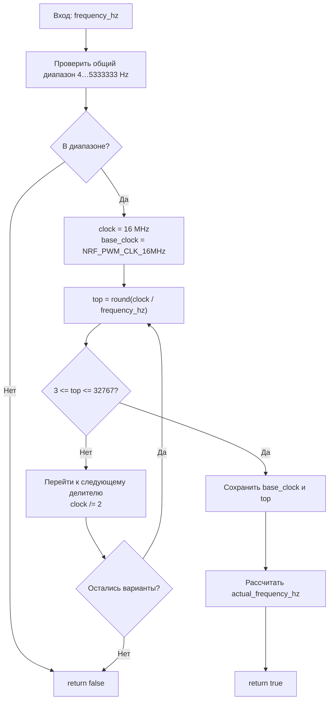
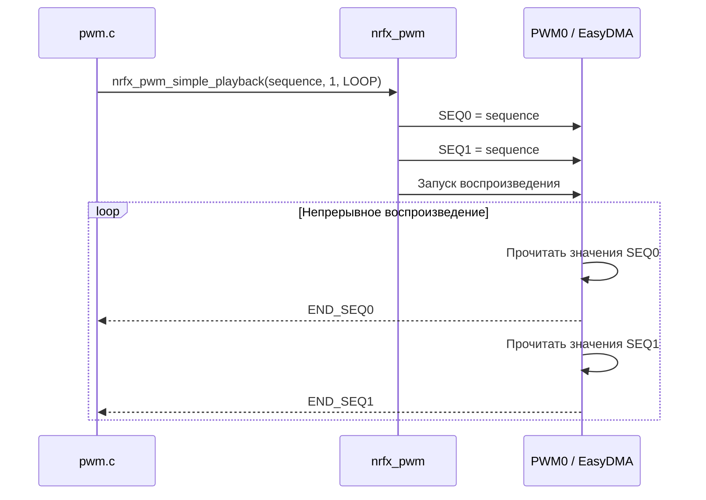
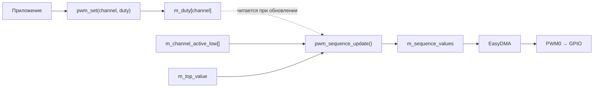
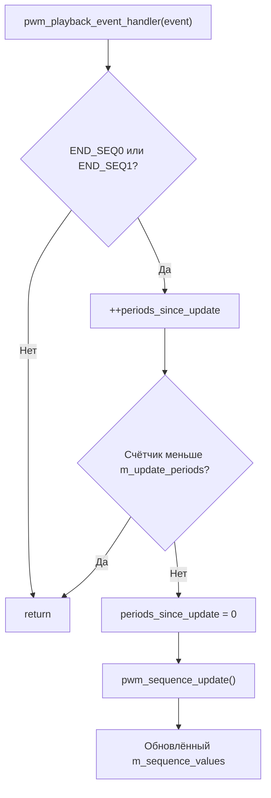
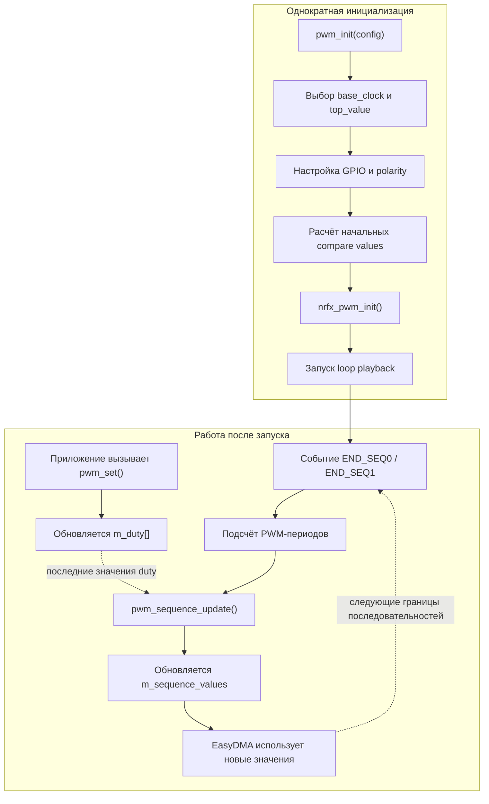

# Аппаратный PWM-модуль

## 1. Назначение и границы ответственности

Модуль `pwm` — низкоуровневая обёртка над аппаратной PWM-периферией nRF52840. Он предоставляет приложению единый интерфейс для управления четырьмя независимыми выходными каналами с общей частотой PWM.

Модуль не знает, что подключено к его выходам. Для него канал — это GPIO, логическое определение активного уровня и текущее значение duty. Поэтому один и тот же драйвер может использоваться для RGB-светодиода, отдельных индикаторов или других устройств, которым требуется PWM.

**Публичный интерфейс намеренно небольшой:**

- `pwm_init()` один раз настраивает периферию и запускает непрерывное воспроизведение;
- `pwm_set()` задаёт новое значение duty для одного канала.

Модуль самостоятельно преобразует логические значения в формат nRF PWM, выбирает подходящую частоту тактирования, обслуживает события окончания последовательностей и периодически обновляет данные, которые читает EasyDMA.

### Место модуля в системе



Внутри модуля обязанности разделены следующим образом:

| Файл | Ответственность |
|---|---|
| `pwm.h` | Публичные типы конфигурации и функции модуля |
| `pwm.c` | Экземпляр PWM0, runtime-состояние, настройка каналов, запуск nrfx, обработчик событий и обновление буфера |
| `internal/pwm_internal.h` | Внутренний тип выбранных таймингов и объявления внутренних функций |
| `internal/pwm_internal.c` | Выбор базовой частоты и периода; преобразование duty/polarity в значения PWM-последовательности |

`pwm_internal.c` не является отдельным драйвером или дополнительным уровнем абстракции. Он содержит вычисления, которые не требуют доступа к состоянию экземпляра периферии и поэтому вынесены из основного файла.

## 2. Публичный интерфейс

### 2.1. Конфигурация каналов

Аппаратный PWM nRF52840 имеет четыре выходных канала. Это число отражено в `PWM_CHANNEL_COUNT`.

`pwm_channel_t` задаёт индекс канала:

- `PWM_CHANNEL_0`;
- `PWM_CHANNEL_1`;
- `PWM_CHANNEL_2`;
- `PWM_CHANNEL_3`.

Для каждого канала конфигурация `pwm_channel_config_t` содержит:

| Поле | Назначение |
|---|---|
| `pin` | GPIO, на который выводится сигнал соответствующего канала |
| `polarity` | Активный логический уровень: `PWM_POLARITY_ACTIVE_HIGH` или `PWM_POLARITY_ACTIVE_LOW` |

Общая конфигурация `pwm_config_t` содержит:

- `frequency_hz` — запрошенную частоту PWM в герцах;
- `channels[]` — четыре конфигурации каналов, индексированные значениями `pwm_channel_t`.

Частота общая для всех четырёх каналов. GPIO и полярность задаются независимо.

В текущем интерфейсе нет специального состояния «канал не используется». Для каждого из четырёх элементов массива необходимо передать допустимый GPIO и корректную полярность. Если канал не нужен приложению, его всё равно требуется сконфигурировать; обычно для него оставляют duty равным нулю.

### 2.2. Инициализация

```c
bool pwm_init(pwm_config_t const *config);
```

Инициализация выполняет всю подготовку периферии и запускает непрерывное воспроизведение PWM. После успешного вызова все четыре канала имеют duty = 0.

Функция возвращает:

- `true` — тайминги выбраны, nrfx PWM успешно инициализирован, воспроизведение запущено;
- `false` — частота не поддерживается или `nrfx_pwm_init()` вернула ошибку.

Нулевой указатель `config`, недопустимые GPIO и неизвестные значения `polarity` считаются нарушением предусловий и проверяются через `ASSERT`. Это не штатные ошибки, которые функция сообщает через `false`.

Модуль рассчитан на однократную инициализацию. Публичного API остановки или деинициализации нет. Вызывать `pwm_set()` можно только после успешного `pwm_init()`.

### 2.3. Изменение duty

```c
void pwm_set(pwm_channel_t channel, uint8_t duty);
```

Значение `duty` — беззнаковое 8-битное число:

| Значение | Логический смысл |
|---:|---|
| 0 | Канал неактивен в течение всего периода |
| 255 | Канал активен в течение всего периода |
| 1…254 | Промежуточная доля активного времени |

Смысл значения не зависит от полярности. Например, duty = 64 означает приблизительно четверть периода в активном состоянии как для active-high, так и для active-low канала. Физический уровень GPIO при этом будет разным.

`pwm_set()` не записывает значение непосредственно в регистры PWM и не пересобирает DMA-буфер. Функция только сохраняет новое значение в runtime-массиве. Аппаратная последовательность будет обновлена обработчиком PWM при достижении очередной границы обновления. Поэтому изменение физического сигнала происходит не обязательно в момент вызова `pwm_set()`.

Индекс канала проверяется через `ASSERT`.

## 3. Состояние модуля и владение данными

Основное состояние хранится в статических переменных `pwm.c`:

| Переменная | Назначение |
|---|---|
| `m_pwm` | Экземпляр nrfx для аппаратного PWM0 |
| `m_channel_active_low[]` | Логическая полярность каждого канала |
| `m_sequence_values` | Постоянный в памяти набор четырёх аппаратных compare values |
| `m_duty[]` | Последние значения duty, переданные приложением |
| `m_top_value` | Выбранное значение счётчика периода |
| `m_update_periods` | Число PWM-периодов между обновлениями DMA-буфера |

Почему данные имеют разное место хранения:

- `m_duty[]` хранит логическое состояние, с которым работает приложение;
- `m_sequence_values` хранит уже рассчитанные аппаратные значения, которые читает EasyDMA;
- `m_channel_active_low[]` и `m_top_value` нужны для повторного преобразования duty в аппаратный формат;
- `m_pwm` связывает модуль с конкретным экземпляром периферии.

`m_sequence_values` объявлен статически, а не локально внутри функции. Это важно: PWM читает последовательность через EasyDMA, поэтому массив должен находиться в RAM и оставаться действительным всё время воспроизведения.

В то же время объект `nrf_pwm_sequence_t` в `pwm_driver_start()` является локальным. Это допустимо: `nrfx_pwm_simple_playback()` использует его при вызове, чтобы записать адрес массива и параметры последовательности в регистры периферии. После настройки периферия обращается к постоянному массиву `m_sequence_values`, а не к локальному объекту-дескриптору.

## 4. Инициализация: последовательность действий

`pwm_init()` сначала рассчитывает конфигурацию, затем формирует начальные данные и только после этого запускает периферию.



### 4.1. Общий режим работы периферии

В `pwm_init()` задаются параметры, одинаковые для всех каналов:

| Параметр | Значение | Причина |
|---|---|---|
| `count_mode` | `NRF_PWM_MODE_UP` | Счётчик движется только вверх; формируется edge-aligned PWM |
| `load_mode` | `NRF_PWM_LOAD_INDIVIDUAL` | У каждого канала собственное значение compare |
| `step_mode` | `NRF_PWM_STEP_AUTO` | Переход к следующему элементу последовательности выполняется аппаратно |
| `irq_priority` | 6 | Фиксированный приоритет прерывания внутри этого модуля |

Выбран режим individual, поскольку каналы должны управляться независимо. В режимах common или grouped несколько каналов разделяли бы одно значение duty, что не соответствует публичному интерфейсу.

### 4.2. Настройка выводов

`pwm_channels_configure()` проходит по всем четырём каналам и:

1. проверяет наличие указанного GPIO;
2. проверяет, что полярность имеет одно из двух допустимых значений;
3. устанавливает начальный duty в ноль;
4. сохраняет признак active-low в `m_channel_active_low[]`;
5. переносит номер GPIO в конфигурацию nrfx;
6. для active-low добавляет к номеру вывода флаг `NRFX_PWM_PIN_INVERTED`.

Флаг `NRFX_PWM_PIN_INVERTED` задаёт начальное неактивное состояние GPIO равным единице. Это важно для active-low: до начала генерации импульсов выход должен находиться в логически неактивном высоком состоянии.

Этот флаг не заменяет настройку полярности compare value. Это две разные настройки, которые решают разные задачи: первая задаёт idle level вывода, вторая — направление активного фронта формируемого PWM-сигнала.

## 5. Выбор частоты и разрешения

Выбор таймингов выполняет `pwm_timing_select()` в `pwm_internal.c`. Функция возвращает структуру `pwm_timing_t`:

- `base_clock` — выбранная базовая частота PWM;
- `top_value` — значение верхней границы счётчика;
- `actual_frequency_hz` — фактическая частота после округления к целым аппаратным параметрам.

### 5.1. Аппаратные ограничения

Источник тактирования PWM равен 16 МГц. Предусмотрено восемь делителей, каждый следующий вдвое больше предыдущего:

| `base_clock` | Делитель от 16 МГц |
|---:|---:|
| 16 МГц | 1 |
| 8 МГц | 2 |
| 4 МГц | 4 |
| 2 МГц | 8 |
| 1 МГц | 16 |
| 500 кГц | 32 |
| 250 кГц | 64 |
| 125 кГц | 128 |

В реализации допустимое значение `top_value` ограничено диапазоном 3…32767. Верхняя граница обусловлена 15-битным полем compare value; нижняя граница принята модулем как минимальное допустимое значение счётчика.

Частота определяется выбранной базовой частотой и количеством тактов в периоде:

```text
frequency = base_clock / top_value
```

Из крайних значений получаются границы диапазона, который проверяет модуль:

```text
minimum frequency = ceil(125000 / 32767) = 4 Hz
maximum frequency = floor(16000000 / 3) = 5333333 Hz
```

Это общий диапазон, достижимый с доступными делителями и допустимыми значениями периода.

### 5.2. Почему выбирается самая быстрая подходящая базовая частота

При фиксированной выходной частоте более быстрая базовая частота позволяет получить больше тактов на один период. Чем больше `top_value`, тем больше дискретных уровней duty можно представить.

Поэтому алгоритм не ищет произвольную комбинацию с минимальной ошибкой частоты. Он предпочитает наибольшую доступную базовую частоту, при которой значение периода остаётся в диапазоне 3…32767. Это даёт максимально возможное разрешение для запрошенной частоты.

### 5.3. Алгоритм выбора



Округление периода к ближайшему целому выполняется целочисленной формулой:

```c
top_value = (clock_frequency_hz + frequency_hz / 2) / frequency_hz;
```

После выбора периода фактическая частота рассчитывается отдельно:

```c
actual_frequency_hz =
    (clock_frequency_hz + top_value / 2) / top_value;
```

Фактическая частота может немного отличаться от запрошенной, поскольку PWM использует целочисленные делитель и период. Это значение сохраняется в `timing.actual_frequency_hz` и далее используется при расчёте интервала обновления последовательности.

Переход к следующему делителю реализован увеличением значения enum `nrf_pwm_clk_t` на единицу и делением частоты на два. Такой код опирается на порядок значений enum в nrfx: от 16 МГц до 125 кГц с шагом в один делитель.

## 6. Преобразование duty в аппаратное значение

В приложении duty задаётся в диапазоне 0…255. PWM-периферия ожидает 16-битное значение, в котором:

- бит 15 определяет полярность выходного сигнала;
- биты 14…0 содержат значение сравнения со счётчиком.

Преобразование одного канала выполняет статическая функция `pwm_channel_compare_value()`.

### 6.1. Пересчёт шкалы

Сначала 8-битное duty переводится в количество активных тактов периода:

```text
active_ticks = round(duty * top_value / 255)
```

В коде округление реализовано без операций с плавающей точкой:

```c
active_ticks =
    ((uint32_t)duty * top_value + UINT8_MAX / 2) / UINT8_MAX;
```

Затем вычисляется compare value:

```text
compare_value = top_value - active_ticks
```

Такое преобразование даёт правильные границы:

| Duty | `active_ticks` | Compare без бита полярности |
|---:|---:|---:|
| 0 | 0 | `top_value` |
| 255 | `top_value` | 0 |

То есть нулевое duty означает отсутствие активного участка, а максимальное duty — активный участок на протяжении всего периода.

Округление к ближайшему целому уменьшает систематическую погрешность при переводе 256 логических уровней в аппаратные такты. Точность конечного результата всё равно ограничена выбранным `top_value`.

### 6.2. Полярность

В nRF PWM старший бит 16-битного значения задаёт полярность фронта:

| Бит 15 | Режим |
|---:|---|
| 0 | Rising-edge |
| 1 | Falling-edge |

Для active-high каналов бит остаётся сброшенным. Для active-low каналов к рассчитанному compare value добавляется `PWM_COMPARE_POLARITY_MASK` (`0x8000`).

```text
15             14                         0
+---------------+--------------------------+
| polarity bit  | 15-bit compare value     |
+---------------+--------------------------+
```

В результате вызывающий код всегда оперирует одним и тем же логическим смыслом duty. Инверсия не должна выполняться на уровне приложения: она является частью преобразования логического значения в формат аппаратной периферии.

### 6.3. Визуальная интерпретация duty

Ниже показан общий смысл активной доли периода. Физический высокий или низкий уровень зависит от полярности канала.

```text
duty = 0       ______________________________
               |<--------- период --------->|

duty = 25%     ____|‾‾‾‾‾‾‾‾‾‾‾‾‾‾‾‾‾‾‾‾‾‾‾‾
               активная часть около 25%

duty = 50%     ____________|‾‾‾‾‾‾‾‾‾‾‾‾‾‾‾
               активная часть около 50%

duty = 100%    ‾‾‾‾‾‾‾‾‾‾‾‾‾‾‾‾‾‾‾‾‾‾‾‾‾‾‾‾
               активна вся длительность периода
```

Графика условная: она показывает долю активного состояния, а не конкретную форму фронтов для каждого режима polarity.

## 7. Формат последовательности и EasyDMA

### 7.1. Режим individual

В конфигурации nrfx используется `NRF_PWM_LOAD_INDIVIDUAL`. В этом режиме четыре последовательных 16-битных значения относятся соответственно к каналам 0, 1, 2 и 3:

```text
m_sequence_values
+-----------+-----------+-----------+-----------+
| channel_0 | channel_1 | channel_2 | channel_3 |
+-----------+-----------+-----------+-----------+
      |           |           |           |
      v           v           v           v
    PWM0        PWM1        PWM2        PWM3
```

Структура `nrf_pwm_values_individual_t` как раз и содержит эти четыре поля. В `pwm_driver_start()` дескриптор последовательности получает:

| Поле | Значение | Смысл |
|---|---:|---|
| `values.p_individual` | `&m_sequence_values` | Адрес постоянного набора значений |
| `length` | `PWM_CHANNEL_COUNT` (4) | Число 16-битных слов в наборе |
| `repeats` | 0 | Не добавлять повторов последнего значения |
| `end_delay` | 0 | Не добавлять задержку после последовательности |

Четыре слова образуют один полный набор compare values для всех каналов. При `NRF_PWM_STEP_AUTO` переход к следующему шагу выполняется аппаратно.

### 7.2. Почему буфер должен находиться в RAM

PWM-периферия не получает новые значения через вызов C-функции на каждом периоде. Она самостоятельно читает последовательность из памяти через EasyDMA.

Поэтому массив:

- должен находиться в RAM, доступной EasyDMA;
- должен существовать всё время воспроизведения;
- не должен быть локальным массивом на стеке;
- может обновляться программой в разрешённый момент на границе последовательности.

Именно поэтому `m_sequence_values` — статическая переменная уровня модуля. Обновление выполняется на месте: указатель, записанный в периферию, остаётся неизменным.

## 8. Непрерывное воспроизведение

Запуском занимается `pwm_driver_start()`.

Сначала вызывается:

```c
nrfx_pwm_init(&m_pwm, config, pwm_playback_event_handler)
```

Если драйвер уже инициализирован или возникла другая ошибка инициализации, функция возвращает код, отличный от `NRFX_SUCCESS`. В этом случае `pwm_driver_start()` возвращает `false`, и запуск воспроизведения не выполняется.

После успешной инициализации создаётся дескриптор `nrf_pwm_sequence_t` и вызывается `nrfx_pwm_simple_playback()` с параметрами:

- `playback_count = 1`;
- `NRFX_PWM_FLAG_LOOP`;
- `NRFX_PWM_FLAG_SIGNAL_END_SEQ0`;
- `NRFX_PWM_FLAG_SIGNAL_END_SEQ1`;
- `NRFX_PWM_FLAG_NO_EVT_FINISHED`.

### 8.1. Почему включены оба события окончания

Аппаратная периферия имеет два слота последовательностей: SEQ0 и SEQ1. При использовании `nrfx_pwm_simple_playback()` драйвер помещает одну и ту же последовательность в оба слота. Это необходимо для непрерывного циклического воспроизведения: один слот не может бесконечно повторяться сам по себе, поэтому nrfx использует оба.

Следствие: при циклическом воспроизведении возникают события окончания и SEQ0, и SEQ1. Оба события должны обрабатываться одинаково. Именно поэтому в конфигурации включены оба флага, а обработчик принимает оба типа событий.



События окончания последовательности генерируются после того, как последнее значение соответствующей последовательности прочитано из RAM. В этот момент данные соответствующей последовательности можно безопасно изменять. В обработчике модуля оба события приводят к одному и тому же пути обновления.

### 8.2. Флаги запуска

| Флаг | Для чего используется |
|---|---|
| `NRFX_PWM_FLAG_LOOP` | Зацикливает воспроизведение |
| `NRFX_PWM_FLAG_SIGNAL_END_SEQ0` | Разрешает callback для окончания SEQ0 |
| `NRFX_PWM_FLAG_SIGNAL_END_SEQ1` | Разрешает callback для окончания SEQ1 |
| `NRFX_PWM_FLAG_NO_EVT_FINISHED` | Отключает ненужное событие завершения конечного воспроизведения |

`NRFX_PWM_FLAG_START_VIA_TASK` не используется. Поэтому `nrfx_pwm_simple_playback()` запускает периферию непосредственно и возвращает ноль. Возвращаемое значение здесь не является кодом статуса и не проверяется как `NRFX_SUCCESS`.

## 9. Обновление duty во время работы

Обновление разделено на две независимые операции:

1. приложение записывает новое логическое значение в `m_duty[]\);
2. обработчик PWM позже переносит актуальные значения в `m_sequence_values\).

Это позволяет не выполнять расчёты и не обращаться к DMA-буферу из каждого вызова `pwm_set()`.

### 9.1. Путь нового значения



`m_duty[]` объявлен как `volatile`, поскольку он изменяется приложением и читается из обработчика прерывания. Это не позволяет компилятору считать, что значение массива не меняется между обращениями, и сохранять его в регистре вместо повторного чтения памяти.

При этом `volatile` не делает групповое обновление четырёх каналов атомарным. Каждый вызов `pwm_set()` меняет только один элемент массива. Если приложение последовательно меняет несколько каналов, обработчик может увидеть уже обновлённые значения одних каналов и ещё старые значения других. Публичный интерфейс не предоставляет транзакционной установки всех четырёх duty одним вызовом.

### 9.2. Обработчик событий

`pwm_playback_event_handler()` получает события от nrfx. Он интересуется только:

- `NRFX_PWM_EVT_END_SEQ0`;
- `NRFX_PWM_EVT_END_SEQ1`.

Все остальные события игнорируются.

При каждом подходящем событии увеличивается локальный счётчик `periods_since_update`. Если требуемое количество периодов ещё не прошло, обработчик сразу возвращается. Когда порог достигнут, счётчик сбрасывается, после чего вызывается `pwm_sequence_update()`.



Счётчик объявлен статической локальной переменной обработчика. Он сохраняет значение между вызовами, но не доступен остальным функциям модуля: это состояние относится только к подсчёту интервала обновления.

### 9.3. Расчёт интервала обновления

Целевой интервал обновления — 10 мс. Важно, что это не отдельный аппаратный таймер и не строго выдерживаемый период. Обновление возможно только на границе PWM-последовательности.

При инициализации число периодов рассчитывается по фактической частоте:

```c
m_update_periods =
    (actual_frequency_hz * PWM_UPDATE_INTERVAL_MS + 500) / 1000;
```

Это округление количества PWM-периодов к ближайшему целому. Если результат равен нулю, он заменяется единицей:

```c
if (m_update_periods == 0)
    m_update_periods = 1;
```

Таким образом, модуль выбирает ближайшее целое количество PWM-периодов к целевым 10 мс, но никогда не обновляет последовательность чаще одного раза за PWM-период.

Примеры:

| Частота PWM | Период PWM | `m_update_periods` | Фактический интервал обновления |
|---:|---:|---:|---:|
| 40 Гц | 25 мс | 1 | 25 мс |
| 60 Гц | 16,67 мс | 1 | 16,67 мс |
| 100 Гц | 10 мс | 1 | 10 мс |
| 120 Гц | 8,33 мс | 1 | 8,33 мс |
| 150 Гц | 6,67 мс | 2 | 13,33 мс |
| 1 кГц | 1 мс | 10 | 10 мс |

Поэтому корректнее говорить об обновлении **примерно раз в 10 мс**. Точность ограничена дискретностью PWM-периода: при низкой частоте интервал не может быть меньше одного периода, а при других частотах округление количества периодов даёт небольшое отклонение от цели.

Использование `actual_frequency_hz`, а не исходного `config->frequency_hz`, учитывает округление, которое произошло при выборе `top_value`.

## 10. Ошибки и ограничения API

### Ошибки, возвращаемые вызывающему коду

`pwm_init()` возвращает `false` в двух случаях:

1. `pwm_timing_select()` не смогла подобрать допустимые аппаратные параметры;
2. `nrfx_pwm_init()` завершилась с кодом, отличным от `NRFX_SUCCESS`.

`nrfx_pwm_simple_playback()` не возвращает код статуса. Без флага `NRFX_PWM_FLAG_START_VIA_TASK` она запускает аппаратную задачу напрямую и возвращает ноль. Поэтому после её вызова модуль считает запуск выполненным и возвращает `true`.

### Проверки предусловий

Через `ASSERT` проверяются:

- указатель `config` в `pwm_init()`;
- наличие каждого GPIO;
- допустимость `polarity`;
- диапазон индекса канала в `pwm_set()`.

Это проверки корректности использования API, а не механизм восстановления после некорректной конфигурации.

### Аппаратная привязка

В текущей реализации используется только PWM0:

```c
static nrfx_pwm_t m_pwm = NRFX_PWM_INSTANCE(0);
```

Поэтому конфигурация SDK должна включать общий драйвер `NRFX_PWM_ENABLED` и экземпляр `NRFX_PWM0_ENABLED`, а реализация nrfx PWM должна участвовать в сборке.

Приоритет прерывания задаётся внутри модуля константой `PWM_IRQ_PRIORITY` и не является частью публичной конфигурации.

### Что модуль намеренно не делает

Модуль не предоставляет:

- остановку или деинициализацию PWM;
- изменение частоты после инициализации;
- атомарную установку duty сразу для нескольких каналов;
- управление RGB/HSV-цветом;
- эффекты, fade, интерполяцию или расписание пользовательских последовательностей;
- знание о назначении конкретного GPIO.

Эти функции относятся к вышележащим уровням. Такое разделение оставляет `pwm` универсальным аппаратным драйвером, а не частью логики конкретного светодиода или эффекта.

## 11. Краткая схема полного цикла



Итак, приложение работает с логической 8-битной шкалой duty, а аппаратный слой самостоятельно переводит её в compare values, поддерживает полярность и обеспечивает непрерывное воспроизведение через PWM0 и EasyDMA.
